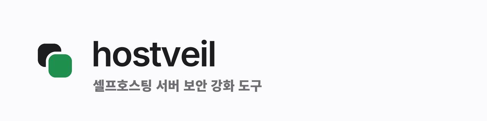
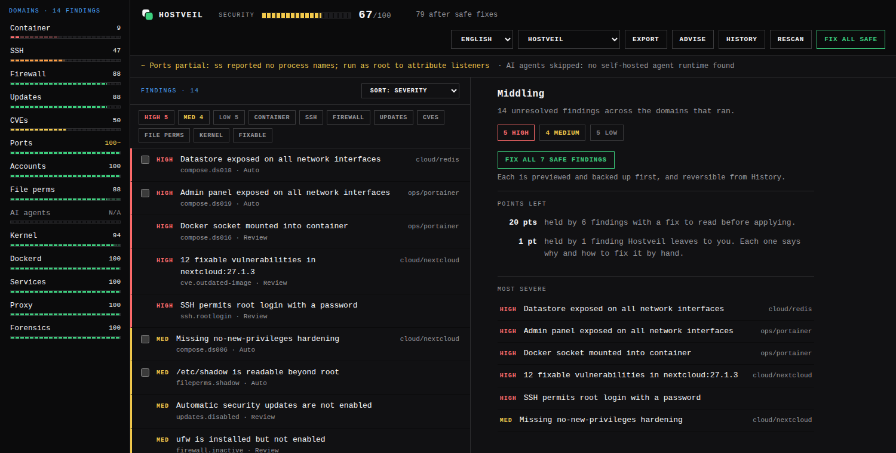
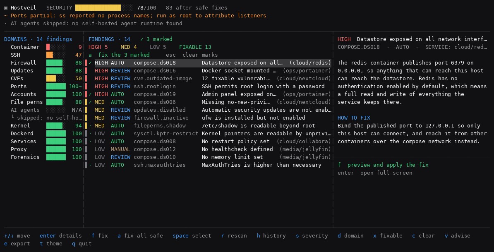
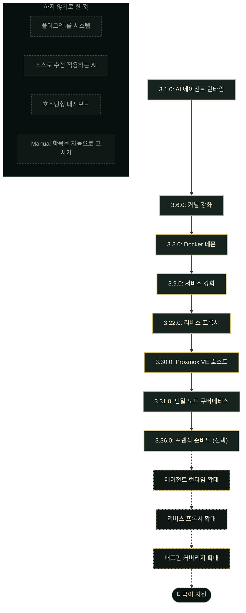

<h1>
  <picture>
    <source media="(prefers-color-scheme: dark)" srcset="site/assets/banner-ko-dark.png">
    
  </picture>
</h1>

[English](README.md) · **한국어**

> 2026-1 Ajou SoftCon 개발부문 최우수상 수상

Hostveil은 셀프호스팅 리눅스 서버의 보안 실수를 찾아 쉬운 말로 설명하고,
고칠 수 있는 것은 고칩니다. 바이너리 하나로 동작하고 설정 파일과 클라우드
계정이 필요 없습니다. 모든 수정은 적용 전에 보여 주고, 원본을 백업한 뒤
적용하며, 명령 한 줄로 되돌릴 수 있습니다.

[](https://github.com/seolcu/hostveil/actions/workflows/ci.yml)
[](https://github.com/seolcu/hostveil/releases/latest)
[](go.mod)
[](LICENSE)

[웹사이트](https://hostveil.seolcu.com/ko/) · [문서](https://hostveil.seolcu.com/ko/docs/) · [변경 이력](CHANGELOG.ko.md) · [최신 릴리스](https://github.com/seolcu/hostveil/releases/latest)

<p align="center">
  
</p>

---

Jellyfin, Nextcloud, 게임 서버, 로컬 LLM, OpenClaw나 Hermes Agent 같은 AI
에이전트를 돌리는 셀프호스팅 서버는 대부분 설치할 때의 기본값을 그대로
씁니다. 잘못된 기본값 하나로 서버를 잃을 수 있습니다. Hostveil은 중요한
설정부터 점검해 0에서 100 사이의 점수를 매기고, 문제마다 전문 용어 없이
설명한 뒤 수정을 제안합니다.

## 서버에 하는 일

- 스캔은 읽기만 합니다. 설정 파일을 열어 보고 `docker`, `ss`, `systemctl`
  같은 도구에 호스트 상태를 묻습니다. 아무것도 바꾸지 않습니다.
- 수정은 정확한 diff나 명령을 먼저 보여 주고, 승인할 때까지 기다립니다.
- 파일을 바꾸기 전에 원본을 체크포인트에 복사합니다. `hostveil rollback`으로
  되돌립니다.
- SSH 로그인이나 방화벽 정책처럼 접속을 끊을 수 있는 수정은 일괄 적용에서
  빠집니다. 경고를 읽고 하나씩 적용합니다.
- 네트워크에는 하루에 한 번 새 릴리스를 확인할 때 접속합니다. 그 밖에는
  `update`를 실행하거나 CVE 스캔을 할 때만 접속합니다.

## 설치

```bash
curl -fsSL https://hostveil.seolcu.com/install.sh | bash
```

[최신 릴리스](https://github.com/seolcu/hostveil/releases/latest)에서 네이티브
패키지를 받아 설치할 수도 있습니다.

```bash
sudo apt install ./hostveil_<version>_linux_amd64.deb   # 또는 dnf install ./hostveil-<version>.x86_64.rpm
```

두 방법 모두 같은 바이너리를 `/usr/bin/hostveil`에 설치합니다. Docker와
`iproute2`를 권장합니다. 없으면 그것이 필요한 영역만 N/A로 나오고 나머지
스캔은 그대로 진행됩니다. 소스에서 빌드하려면 Go 1.26 이상이 필요합니다.

```bash
go install github.com/seolcu/hostveil/cmd/hostveil@latest
```

Trivy는 선택 사항이며 이미지와 패키지의 CVE 스캔을 더합니다. 업그레이드와
제거는 설치 방식과 상관없이 `hostveil update`와 `hostveil uninstall`이
처리합니다. 릴리스에는 체크섬, 서명된 빌드 프로버넌스, SBOM이 함께
제공됩니다. 실행 전에 내려받은 파일을 검증하는 방법은
[설치](https://hostveil.seolcu.com/ko/docs/installation) 문서에 있습니다.

## 세 가지 인터페이스

<p align="center">
  
</p>

세 인터페이스는 같은 엔진을 씁니다. 한 곳에서 적용한 수정을 다른 곳에서
되돌릴 수 있습니다.

- 웹 대시보드(`hostveil serve`): 서버 보안이 처음이라면 여기서 시작합니다.
  localhost에만 열리고, 일회용 접근 토큰이 담긴 URL을 출력합니다. 그 URL을
  그대로 엽니다. 루프백이라 네트워크에서는 닿지 않지만 같은 머신의 다른
  계정은 접근할 수 있고, 대시보드는 root로 실행됩니다. 다른 컴퓨터에서 보려면
  SSH로 포트를 포워딩합니다.
- TUI(터미널에서 `hostveil`): 키보드로 다룹니다. SSH로 서버를 관리하는
  사람을 위한 화면입니다.
- CLI(`scan`, `fix`, `rollback`, `--json`): 스크립트, cron, CI용입니다.

대시보드는 영어와 한국어로 볼 수 있습니다. 브라우저의 언어를 따르고, 상태
표시줄의 선택기로 바꾸면 그 브라우저에서 기억합니다. 번역한 발견 항목마다
영어 원문을 펼쳐 볼 수 있습니다. 원문에는 호스트의 이름, 경로, 개수가 그대로
들어 있습니다. TUI와 CLI는 영어로만 나옵니다.

TUI와 대시보드는 `hostveil`(기본값), `onedark`, `gruvbox`, `nord`,
`catppuccin`, `tokyonight` 여섯 가지 색상 테마를 함께 씁니다. TUI에서 `t`를
누르면 테마를 고르고 기억합니다. 대시보드에서는 상태 표시줄의 선택기를
씁니다. `--theme`이나 `HOSTVEIL_THEME`으로 지정할 수도 있습니다.

TUI와 `scan`은 패치된 [Nerd Font](https://www.nerdfonts.com/)의 기호로 상태를
표시할 수 있습니다. `--glyphs nerd`나 `HOSTVEIL_GLYPHS=nerd`로 켭니다. 터미널이
어떤 폰트를 쓰는지 알려 주지 않아서 직접 켜야 합니다. 테마 스크린샷과 Nerd
Font 설명은 [인터페이스](https://hostveil.seolcu.com/ko/docs/interfaces) 문서에
있습니다.

## 사용법

```bash
hostveil                 # 대화형 TUI (터미널에서의 기본값)
hostveil scan            # 점수가 매겨진 보고서 출력 (-v 상세, --json JSON)
hostveil fix <id>        # 발견 항목 하나를 미리 보고 수정 적용
hostveil fix --all       # 안전한(Auto) 항목을 한 번에 모두 적용
hostveil fix --all --review  # Review 항목까지, 무엇인지 읽고 나서
hostveil rollback <id>   # 이미 적용한 수정을 되돌리기
hostveil history         # 적용된 수정과 롤백 ID 목록
hostveil history --scans # 저장된 모든 스캔의 점수, 오래된 것부터
hostveil diagnostics     # 버전·배포판·크래시·스캔 정보를 파일 하나로 정리 (전송 기능 없음)
hostveil explain <id>    # 발견 항목 설명 (--ai로 AI 2차 소견 추가)
hostveil export --format markdown --output report.md  # json, sarif도 가능
hostveil ai-context "개인 미디어 서버, 안정성보다 최신 패치가 중요함"
hostveil explain --ai    # 어떤 Fix가 이 호스트에 맞고 안 맞는지 판단
hostveil serve           # 127.0.0.1:8787 웹 대시보드 (출력된 URL을 여세요)
hostveil update          # 설치된 방식 그대로 이 바이너리를 갱신
hostveil uninstall       # 체크포인트는 남기고 제거
```

일부 점검은 root 소유 파일을 읽고, 수정을 적용할 때도 root가 필요합니다.
Hostveil은 필요할 때 `sudo`로 자신을 다시 실행합니다. 비밀번호 프롬프트는
`sudo hostveil`과 같습니다. `version`과 `help`는 비밀번호를 묻지 않습니다.
스크립트나 CI에서는 `HOSTVEIL_NO_SUDO=1`을 설정합니다. 그러면 root가 필요한
영역은 건너뛰고 그 사실을 메시지로 알립니다.

### CI와 cron용 종료 코드

`hostveil scan`은 결과를 종료 상태로 알려 줍니다. 예약 점검에서 출력을
파싱할 필요가 없습니다.

| 코드 | 의미 |
| --- | --- |
| `0` | 스캔이 실행됐고 high 항목이 없음. |
| `1` | 고치지 않은 high 발견 항목이 하나 이상 있음. |
| `3` | 탐지 영역 하나가 완전히 실패해서 스캔이 호스트를 다 보지 못했음. |

```bash
HOSTVEIL_NO_SUDO=1 hostveil scan --json > report.json || echo "조치 필요"
```

종료 코드 3도 처리하세요. 실패한 영역은 발견 항목을 내지 않습니다. 종료
상태만 보는 쪽에서는 아무것도 보지 못한 스캔과 문제없는 호스트가 같은
결과로 보입니다. `--sarif`는 GitHub 코드 스캐닝과 대부분의 CI가 읽는 SARIF
2.1.0으로 내보내고, `--only`/`--skip`은 실행할 영역을 좁힙니다. 전체 플래그와
SARIF 매핑은 [CLI 참조](https://hostveil.seolcu.com/ko/docs/cli)에 있습니다.

나머지 명령은 성공하면 0, 실패하면 1, 사용법이 틀리면 2로 종료합니다.

### 문제 해결

`HOSTVEIL_DEBUG=1`을 설정하면 Hostveil이 호스트에서 실행하는 모든 명령을
표준 오류로 기록합니다. 무엇을 실행했는지, 얼마나 걸렸는지, 실패했는지가
나옵니다. 명령의 출력은 기록하지 않습니다. `docker inspect`가 모든 컨테이너의
환경 변수를 출력하기 때문에, 출력까지 기록하면 자격 증명이 들어갑니다.

```bash
HOSTVEIL_DEBUG=1 hostveil scan
```

저하(Degraded), 거절된 롤백, 빈 히스토리, 종료 코드 3의 의미는
[문제 해결](https://hostveil.seolcu.com/ko/docs/troubleshooting) 문서에 있습니다.

## 수정 종류

모든 발견 항목은 네 종류 중 하나입니다.

| 종류 | 뜻 | Hostveil이 적용 가능 |
| --- | --- | --- |
| Auto | 올바른 변경이 하나뿐입니다. 적용 전에 보여 줍니다. | 예 |
| Review | 대안이 하나 이상 있고 각각 장단점이 있습니다. 하나를 고릅니다. | 예 |
| Manual | 안전하게 자동화할 방법이 없습니다. 해야 할 일을 설명합니다. | 아니요 |
| Unavailable | 실제 문제지만 아직 고칠 방법이 없습니다. 패치가 나오지 않은 CVE가 여기에 속합니다. | 아니요 |

`fix --all`은 Auto만 적용합니다. `fix --all --review`는 Review 항목도 각각의
첫 번째 대안으로 적용합니다.

Auto가 되려면 다음 세 조건을 모두 만족해야 합니다.

- 되돌릴 수 있습니다. 체크포인트가 바뀐 내용을 그대로 복원합니다. 명령을
  실행하는 수정은 복원할 것이 남지 않으므로 Auto가 될 수 없습니다.
- 내 접속을 끊을 수 없습니다. SSH 인증과 방화벽 정책은 편집을 깨끗하게
  되돌릴 수 있어도 Auto에서 빠집니다.
- 올바른 조치가 하나뿐입니다.

조건을 하나라도 만족하지 못하면, 고를 대안이 있을 때는 Review가 되고, 할 일은
하나인데 안전하게 자동화할 수 없을 때는 Manual이 됩니다. 전체 절차는
[수정 및 롤백](https://hostveil.seolcu.com/ko/docs/fixing)에 있습니다.

파일에 쓴 뒤에 늦게 반영되는 변경도 있습니다. Compose 파일은 컨테이너를 다시
만들 때, systemd 드롭인은 유닛을 다시 읽을 때, sysctl 드롭인은 다음 부팅 때
읽힙니다. 그때까지 해당 항목은 점수에 남고 행에 `PEND`가 붙습니다. 각 수정은
반영하는 데 필요한 명령을 알려 줍니다.

## 점수 계산

점수는 0에서 100 사이의 숫자입니다. 각 탐지 영역은 100점 중 정해진 몫을 가진
축입니다. 실행되지 않은 영역은 N/A로 표시하고, 나머지 축이 그 몫을 나눠
가집니다. Docker가 없는 호스트라고 점수를 더 받지는 않습니다. 아무 영역도
실행되지 않았다면 점수는 N/A입니다.

축 안에서는 발견 항목마다 남은 몫의 일정 비율을 깎습니다. 그래서 열 번째
항목도 점수를 깎습니다. 비율은 심각도가 정합니다.

| 단계 | 뜻 | 축에 남은 몫에서 깎는 비율 |
| --- | --- | --- |
| high | 아무것도 갖지 않은 사람이 호스트 밖에서 지금 닿거나 쓸 수 있습니다. | 2분의 1 |
| medium | 발판, 추측한 자격 증명, 로컬 계정 중 하나가 있어야 합니다. | 8분의 1 |
| low | 심층 방어입니다. 오늘 알려진 공격 경로는 없습니다. | 16분의 1 |

같은 발견 항목 ID가 한 축에서 반복되면 조화급수로 가중치를 줄입니다. 서비스
네 개가 같은 설정을 빠뜨렸다면 실수 하나를 네 번 한 것으로 셉니다. 아직 고칠
방법이 없는 항목(패치가 나오지 않은 CVE)도 그대로 감점합니다. 패치가 있든
없든 위험은 같기 때문입니다. 그런 항목이 있는 호스트는 취약점 축에서 100점이
되지 않을 수 있습니다. 전체 점수에는 이름도 붙습니다. 80 이상은 *상태가 좋음*,
50에서 79는 *그저 그럼*, 25에서 49는 *노출됨*, 25 미만은 *활짝 열림*입니다.

대시보드와 `hostveil scan`은 점수 아래에 남은 점수와 그 이유를 보여 줍니다.
재시작 후 돌아오는 점수, 직접 고칠 수 있는 Manual 항목의 점수, 아직 수정이
나오지 않은 항목의 점수입니다.

전체 모델과 축별 몫은 [점수 체계](https://hostveil.seolcu.com/ko/docs/scoring)
페이지에 있습니다.

## 점검 범위

발견 항목 ID는 그것을 찾은 영역 이름으로 시작합니다. 두 번째 열의 접두사를
`hostveil fix`와 `hostveil explain`에 넣습니다.

| 영역 | 발견 항목 | 점검 내용 | 필요한 것 |
| --- | --- | --- | --- |
| Docker / Compose | `compose.*` | 특권 모드, Docker 소켓 마운트, 노출된 데이터 저장소와 관리자 패널, 호스트 네트워킹, 위험한 바인드 마운트, 공유된 PID·IPC 네임스페이스, 쓰기 가능한 루트 파일시스템, 빠진 no-new-privileges, 하드코딩된 비밀값 등. Compose 파일을 직접 읽고, `docker run`으로 띄운 컨테이너도 봅니다 | Docker |
| SSH | `ssh.*` | root 로그인, 비밀번호 인증, 빈 비밀번호, 느슨한 무차별 대입 제한, 로그인 유예 시간, 게이트웨이 포트, 호스트 기반·키보드 대화형 인증, X11 포워딩. `sshd_config`를 직접 읽고 `Include`를 따라 `sshd_config.d/`까지 읽습니다. 첫 `Match` 블록에서 읽기를 멈추고 부분 점검으로 보고합니다. `Match` 안의 지시어는 일부 접속에만 적용되기 때문입니다 | — |
| 방화벽 | `firewall.*` | ufw, firewalld, nftables, iptables 중 무엇이 켜져 있는지, 컨테이너가 게시한 포트가 방화벽을 우회하는지 | — |
| 자동 업데이트 | `updates.*` | unattended-upgrades(apt)나 dnf-automatic(dnf)이 켜져 있는지 | — |
| 노출된 서비스 | `ports.*` | 루프백이 아닌 주소에서 대기 중인 호스트 프로세스를 `ss`에서 읽습니다. Docker 밖에 설치한 데이터베이스, 관리자 패널, 앱이 여기서 잡힙니다. Compose 감사로는 보이지 않는 것들입니다 | `ss` |
| 계정 | `accounts.*` | 누가 root가 될 수 있는지 봅니다. UID 0을 가진 root 아닌 계정, 비밀번호가 빈 로그인 계정, 비밀번호 없이 무엇이든 root로 실행하게 해 주는 sudo 규칙이 걸린 계정(클라우드와 VM 이미지가 첫 로그인을 위해 넣어 두는 규칙)입니다. 각 계정이 무엇을 실행할 수 있는지는 sudo에 직접 묻습니다 | root (`/etc/shadow`와 sudo 때문에) |
| 파일 권한 | `fileperms.*` | `/etc/shadow`, `/etc/passwd`, `/etc/group`, `sshd_config`, SSH 호스트 개인 키의 과도한 권한 | — |
| AI 에이전트 런타임 | `agent.*` | OpenClaw, Hermes Agent, Goose를 봅니다. 다른 기계에서 닿는 게이트웨이, 그런 게이트웨이에서 꺼진 인증, 제한 없는 셸과 권한 상승 도구, 꺼진 샌드박스, 설정 파일과 그 옆 API 키의 느슨한 권한 | — |
| 커널 강화 | `sysctl.*` | `/proc/sys`에서 읽는 커널 파라미터 여덟 개. 로컬 사용자나 위조된 패킷이 할 수 있는 일을 제한하는 설정입니다. `sysctl` 바이너리는 필요 없습니다 | — |
| Docker 데몬 | `dockerd.*` | 컨테이너를 돌리는 데몬. TLS 클라이언트 검증 없이 TCP로 열린 API는 포트에 닿는 누구에게나 root 권한을 줍니다. 누구나 쓸 수 있는 소켓, 소켓 그룹의 구성원, no-new-privileges·userns-remap·live-restore 기본값도 확인합니다 | Docker |
| 서비스 강화 | `systemd.*` | 직접 설치한 유닛을 systemd의 실효 설정으로 읽습니다. 서비스가 setuid로 권한을 얻을 수 있는지, `/usr`와 `/etc`에 쓸 수 있는지, 모든 사용자의 홈 디렉터리를 읽을 수 있는지, `/tmp`를 호스트와 공유하는지 봅니다. 배포판이 넣은 유닛은 배포판에 맡깁니다 | systemd |
| 리버스 프록시 | `proxy.*` | nginx는 `/etc/nginx`에서 읽고 `include`를 따라 `conf.d`와 `sites-enabled`까지 들어가 폐기된 TLS 버전과 디렉터리 목록 노출을 봅니다. Caddy는 `/etc/caddy`나 컨테이너에 마운트된 Caddyfile에서 읽어 루프백 밖에서 열린 관리 API와 `file_server browse`를 봅니다. 관리 API는 인증이 없고 설정 전체를 바꿀 수 있습니다. Traefik은 Compose 파일에서 읽어 insecure 모드의 대시보드를 찾습니다. 이 대시보드는 로그인 없이 모든 백엔드 주소를 보여 줍니다 | — |
| Proxmox VE 호스트 | `proxmox.*` | `/etc/pve`가 있는 호스트에서만 봅니다. 어느 주소에서든 로그인을 받는 8006번 웹 인터페이스, 비밀번호만으로 로그인하는 root@pam, 구독 없이 켜 둔 엔터프라이즈 저장소를 찾습니다. 마지막 경우에는 Proxmox 자체 패키지의 업데이트가 멈춥니다. 데이터센터 방화벽은 방화벽 영역이 한 번만 셉니다 | Proxmox VE 호스트 |
| 단일 노드 쿠버네티스 | `kube.*` | k3s나 k0s 노드 하나를 봅니다. k3s 설정은 config.yaml, 드롭인, 서비스 환경 파일, 명령행을 모두 합쳐 읽습니다. 모든 계정이 읽을 수 있는 클러스터 관리자 kubeconfig나 참여 토큰, API 서버나 kubelet의 `anonymous-auth=true`, 암호화되지 않은 Secret 저장을 찾습니다 | k3s 또는 k0s |
| 포렌식 준비도 *(선택)* | `forensic.*` | 조사에 필요한 증거가 남는지 봅니다. 재부팅 후에도 남고 90일을 보관하는 저널, 90일 동안 보관되는 인증·웹 로그, 웹 서버 계정이 실행하는 프로그램을 기록하는 auditd, 동기화된 시계, 접근 로그의 요청 크기, 다른 기계에 보내는 로그 사본 | `--with forensic` |
| 이미지 CVE *(선택)* | `cve.*` | Compose 서비스가 실행하는 이미지와, 배포판이 아직 고치지 않은 호스트 패키지의 알려진 취약점 | Trivy |

포렌식 준비도는 기본으로 꺼져 있습니다. 조사에 필요한 증거가 남는지 보는
영역이라 홈서버보다 조직에 더 의미가 있습니다. 포함하려면 `--with forensic`을
붙입니다.

Docker나 Trivy가 없으면 해당 영역은 건너뛰고, 실행된 영역만으로 점수를 다시
계산합니다. 보지 못한 영역이 만점으로 나오는 일은 없습니다.

<!-- hostveil:counts -->
Hostveil은 이 영역들에서 발견 항목 194개를 보고할 수 있습니다. 그중 181개에
수정이 붙어 있습니다. 77개는 무인으로 적용하고, 104개는 차이를 읽은 뒤에만
적용합니다.
<!-- /hostveil:counts -->

나머지는 Manual입니다. Hostveil이 각 항목을 사용자에게 맡기는 이유는
[`internal/fix/register.go`](internal/fix/register.go)에 적혀 있습니다. 이유가
적히지 않은 Manual 항목이 생기면 빌드가 실패합니다.

## 측정 결과

2026년 9월 11일에 Ubuntu VM의 설정을 약하게 바꾼 뒤 Lynis, Docker의 CIS
벤치마크, Docker 브리지의 컨테이너에서 실행한 TCP 스캔, 커널의 수신 소켓
목록으로 측정했습니다. VM은 Nextcloud와 PostgreSQL, Jellyfin과 Redis,
Portainer와 Watchtower를 실행합니다. root SSH 로그인을 허용했고 방화벽과 자동
업데이트를 껐습니다.

| 측정 항목 | 수정 전 | Auto·Review 적용 및 재시작 후 |
| --- | --- | --- |
| Docker 브리지에서 응답한 포트 | 6 | 1 |
| CIS Docker 벤치마크 (통과 / 경고) | 17 / 15 | 20 / 12 |
| Lynis 하드닝 지수 | 57 | 79 |
| Hostveil SSH 영역 | 10/100 | 100/100 |
| Hostveil 점수 | 28 | 58 |

소스 커밋 `290b4d1`을 `v3-dev`로 빌드해 `scripts/measure/seed.sh`의 구성에서
측정했습니다. [실행 기록](docs/measurements/2026-09-11-cisc-w2026.md)에 원본
출력과 측정 방법이 있습니다. "적용 후" 열에는 Review 조치와 서비스 재시작이
포함됩니다. `fix --all`만 실행하면 결과가 이보다 낮습니다.

체크포인트 79개를 롤백해 변경된 경로 28개 중 25개를 복원했습니다(89%).
Review 수정 40건 중 16건은 되돌릴 것이 없어서 `[not reversible]`로 표시됩니다.
세 경로에 변경이 남았습니다. 계정 잠금 명령이 바꾼 `/etc/shadow`, 패키지
업그레이드가 다시 쓴 `/etc/issue`와 `/etc/issue.net`입니다. 체크포인트 롤백은
모두 오류 없이 끝났지만 호스트는 원래 상태로 완전히 돌아오지 않았습니다.

컨테이너 점수는 0 근처에 머물렀고 CVE 점수는 오르지 않았습니다. Lynis 경고
3건 중 2건은 추가 UID 0 계정에 관한 것입니다. Hostveil도 이 계정을 보고하고
수동 조치로 남깁니다. 수정 후 TCP 스캔에서는 SSH만 응답했지만, 커널의 수신
목록에는 모든 인터페이스에서 대기하는 SSH와 Redis가 남았습니다. 수신 소켓과
도달 가능한 포트는 서로 다른 관찰입니다.

별도의 새 VM을 `control.sh`로 하드닝하고 Hostveil은 스캔만 한 대조군에서는
점수가 28에서 38로 올랐습니다. 외부 스캔에서 응답한 포트는 7개에서 2개로
줄었고 수신 소켓은 7개 그대로였습니다. 그 실행에서는 원인을 밝히지
못했습니다.

전체 결과와 한계는 [측정 결과](https://hostveil.seolcu.com/ko/docs/measurements)
페이지에 있습니다. `scripts/measure/run.sh -c`는 지워도 되는 VM이나
컨테이너에서만 실행합니다. 이 검사는 되돌릴 수 없는 Review 조치가 남긴 변경을
허용하므로, 통과했다고 모든 파일이 복원된 것은 아닙니다.

## 관련 도구

- [Lynis](https://github.com/CISOfy/lynis)는 관리자를 위한 꼼꼼한 호스트
  감사 도구입니다. 긴 제안 목록을 출력하고 적용은 하지 않습니다. 결과를
  읽으려면 어떤 항목이 중요한지 알아야 합니다.
- [docker-bench-security](https://github.com/docker/docker-bench-security)는
  Docker 호스트를 CIS 벤치마크와 비교합니다. 컨테이너만 보고, 찾은 문제를
  보고만 합니다.
- [Trivy](https://github.com/aquasecurity/trivy)는 이미지와 파일시스템에서
  알려진 CVE와 설정 오류를 찾습니다. Hostveil의 CVE 영역이 Trivy를 실행합니다.
  Trivy는 SSH, 방화벽, 계정을 보지 않습니다.

Hostveil은 호스트, 컨테이너, CVE를 점수 하나로 합치고, 항목마다 설명을 붙이고,
미리보기와 백업과 롤백을 갖춘 수정을 적용합니다.

## 테스트

Hostveil은 root로 실행되고, 사람들이 쓰는 서버의 설정 파일을 고칩니다. 다음
검사들이 이를 뒷받침합니다.

- [`internal/docs/`](internal/docs)는 공개된 페이지가 코드와 어긋나면 빌드를
  실패시킵니다. 모든 영역 표, 스크린샷 속 발견 항목 ID, 측정 결과 페이지의
  수치를 프로그램과 대조합니다.
- 매일 밤 퍼즈 타깃 5개를 각각 5분씩 실행합니다. 설정 파일을 다시 쓰는
  편집기와 파서가 대상입니다.
- 모든 풀 리퀘스트에서 실제 바이너리로 스캔, 수정, 히스토리, 롤백, 재스캔을
  차례로 실행합니다. 약한 설정을 넣은 Debian 컨테이너 안에서 실행합니다.
- 모든 풀 리퀘스트에서 모든 릴리스 대상을 크로스 컴파일합니다.
- [`demo/`](demo/README.md)는 약한 설정을 넣은 Vagrant VM입니다. 내 서버에
  쓰기 전에 Hostveil이 서버를 고치는 과정을 볼 수 있습니다.

이 검사들은 코드가 설명대로 동작하는지 확인합니다. 수정이 실제 호스트를
개선하는지는 [`scripts/measure/`](scripts/measure)의 하네스가 측정하며, 그
결과가 위의 측정 결과입니다.

## AI (선택)

`hostveil explain <id> --ai`는 AI 모델이 쓴 쉬운 설명을 덧붙입니다. 기본
프로바이더는 내 기계에서 실행하는 Ollama이므로 호스트 밖으로 아무것도 나가지
않습니다. 로컬 모델을 돌리기 어려운 기계에서는 `HOSTVEIL_AI_PROVIDER=anthropic`
또는 `openai`로 외부 API를 쓸 수 있습니다. 인증 정보는 `ANTHROPIC_API_KEY`나
`HOSTVEIL_OPENAI_API_KEY`로 설정하고, 전체 변수 목록은
`hostveil explain --help`에 있습니다. 모델에는 발견 항목의 제목, 설명, 수정
방법, 서비스 이름만 보냅니다. 원본 증거는 보내지 않습니다. AI는 조언만 하고
변경을 적용하지 않으며, 모든 설명과 점수와 수정은 AI 없이 동작합니다.

## 네트워크 사용

Hostveil은 하루에 한 번 GitHub 릴리스 페이지에서 새 버전을 확인합니다. 요청에
호스트 정보는 담기지 않고, 응답은 캐시하며, `HOSTVEIL_NO_UPDATE_CHECK=1`로 끌
수 있습니다. 그 밖에는 `update`를 실행할 때와 CVE 스캔 중 Trivy가 취약점
데이터를 받을 때만 네트워크에 접속합니다.

## 로드맵

새 점검 영역을 추가하면 기존 영역의 가중치를 나눠 받는 새 점수 축이 생깁니다.
그래서 영역 하나하나를 이름 붙은 릴리스로 냅니다. 실선은 출시된 항목, 점선은
일정 없이 계획된 항목입니다. 맨 아래 상자는 하지 않기로 한 항목입니다.



각 항목의 이유와 "하지 않기로 한 것"으로 정한 이유는
[로드맵](https://hostveil.seolcu.com/ko/docs/roadmap) 페이지에 있습니다.

## 소스에서 빌드하기

```bash
go build ./cmd/hostveil
go test ./...
```

플랫폼별 데모 VM, 저장소 구조, 기여 체크리스트를 포함한 전체 설정은
[docs/DEVELOPMENT.md](docs/DEVELOPMENT.md)에 있습니다.

## 라이선스

[GPL-3.0](LICENSE)

> Team 내컴퓨터누가해킹했어 ([@gkdms04](https://github.com/gkdms04), [@seolcu](https://github.com/seolcu))
