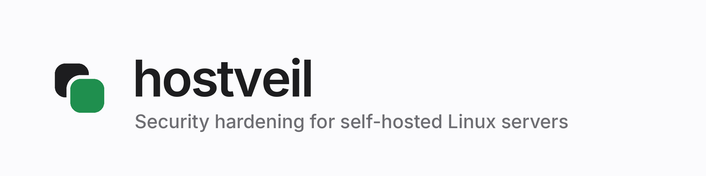
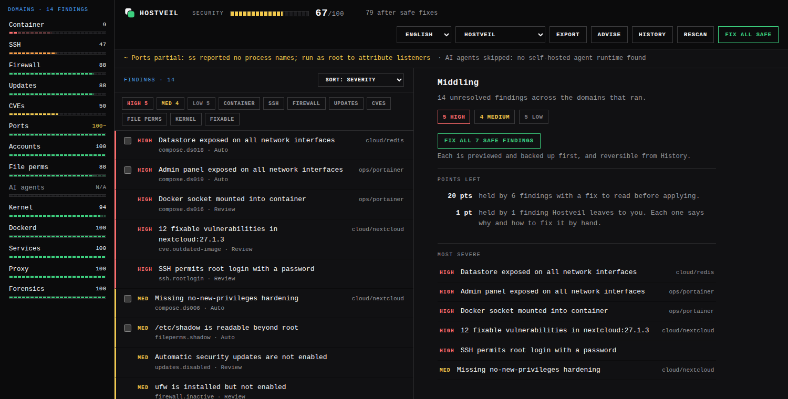
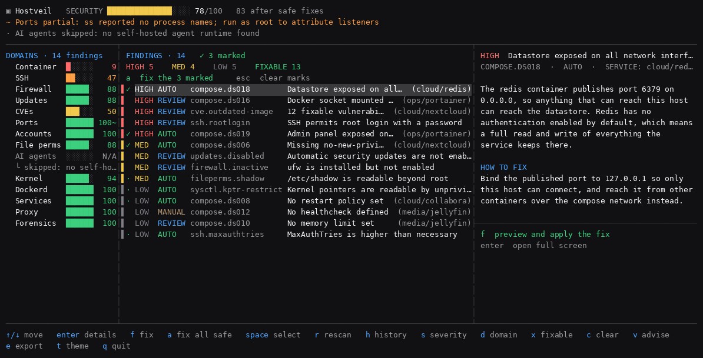
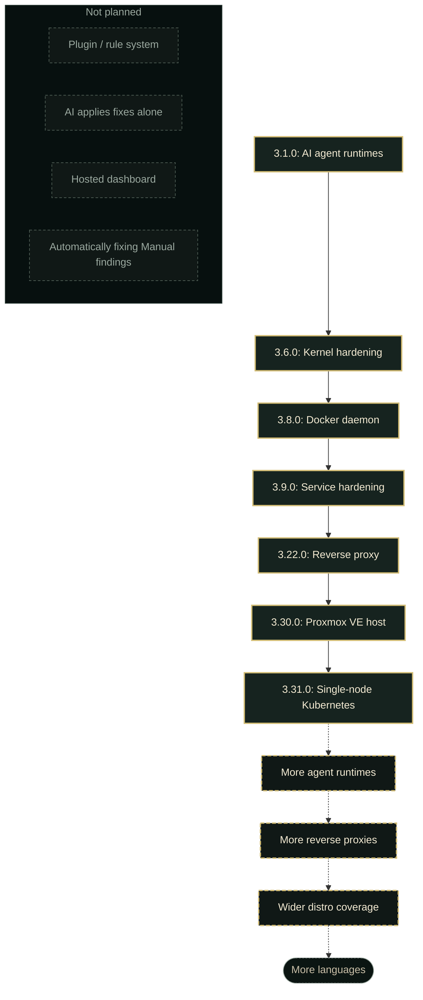

<h1>
  <picture>
    <source media="(prefers-color-scheme: dark)" srcset="site/assets/banner-dark.png">
    
  </picture>
</h1>

**English** · [한국어](README.ko.md)

Hostveil checks a self-hosted Linux server for security mistakes, explains each
one in plain language and fixes the ones it can. It is one binary with no
config file and no cloud account. Every fix is shown before it runs, backed up
first and can be undone with one command.

[](https://github.com/seolcu/hostveil/actions/workflows/ci.yml)
[](https://github.com/seolcu/hostveil/releases/latest)
[](go.mod)
[](LICENSE)

[Website](https://hostveil.seolcu.com/) · [Docs](https://hostveil.seolcu.com/docs/) · [Changelog](CHANGELOG.md) · [Latest release](https://github.com/seolcu/hostveil/releases/latest)

> Winner of the Grand Prize (Development) at the 2026-1 Ajou University SoftCon.

<p align="center">
  
</p>

---

Most self-hosted servers (Jellyfin, Nextcloud, a game server, a local LLM, an
AI agent such as OpenClaw or Hermes Agent) run on the defaults their installer
left behind. One bad default can be enough to lose the machine. Hostveil checks
the settings that matter most, gives the server a score from 0 to 100, explains
each problem without jargon and offers a fix.

## What it does to your server

- A scan only reads. It opens configuration files and asks tools such as
  `docker`, `ss` and `systemctl` about the host. It changes nothing.
- A fix shows the exact diff or command first and waits for you to accept it.
- Before a file changes, Hostveil copies the original into a checkpoint.
  `hostveil rollback` puts it back.
- Fixes that could lock you out (SSH login, firewall policy) are never applied
  in bulk. You apply them one at a time after reading the warning.
- Hostveil contacts the network once a day to check for a newer release, and
  otherwise only when you run `update` or a CVE scan.

## Install

```bash
curl -fsSL https://hostveil.seolcu.com/install.sh | bash
```

You can also install a native package from the
[latest release](https://github.com/seolcu/hostveil/releases/latest):

```bash
sudo apt install ./hostveil_<version>_linux_amd64.deb   # or dnf install ./hostveil-<version>.x86_64.rpm
```

Both routes install the same binary at `/usr/bin/hostveil`. Docker and
`iproute2` are recommended. Without them, the domains that need them report N/A
and the rest of the scan runs. Building from source needs Go 1.26 or later:

```bash
go install github.com/seolcu/hostveil/cmd/hostveil@latest
```

Trivy is optional and adds image and package CVE scanning. `hostveil update`
and `hostveil uninstall` handle upgrades and removal for every install method.
Releases are checksummed and carry a signed build provenance attestation and an
SBOM. [Installation](https://hostveil.seolcu.com/docs/installation) shows how to
verify a download before you run it.

## Three interfaces

<p align="center">
  
</p>

All three run on one engine, so a fix applied in one can be undone from
another.

- Web dashboard (`hostveil serve`): the place to start if server security is
  new to you. It binds to localhost and prints a URL with a one-off access
  token; open that exact URL. Loopback keeps the dashboard off the network, but
  other accounts on the same machine can still reach it, and it runs as root.
  From another computer, forward the port over SSH.
- TUI (`hostveil` on a terminal): keyboard-driven, for people who manage the
  server over SSH.
- CLI (`scan`, `fix`, `rollback` with `--json`): for scripts, cron and CI.

The TUI and the dashboard share six color themes: `hostveil` (the default),
`onedark`, `gruvbox`, `nord`, `catppuccin` and `tokyonight`. Press `t` in the
TUI to pick one and have it remembered, use the picker in the dashboard's
status bar, or set `--theme` or `HOSTVEIL_THEME`.

The TUI and `scan` can draw their status markers from a patched
[Nerd Font](https://www.nerdfonts.com/) with `--glyphs nerd` or
`HOSTVEIL_GLYPHS=nerd`. It is opt-in because a terminal cannot report which font
it uses. [Interfaces](https://hostveil.seolcu.com/docs/interfaces) has theme
screenshots and Nerd Font details.

## Usage

```bash
hostveil                 # interactive TUI (default on a terminal)
hostveil scan            # print a scored report (add -v for details, --json for JSON)
hostveil fix <id>        # preview, then apply the fix for one finding
hostveil fix --all       # apply every safe (Auto) fix at once
hostveil fix --all --review  # and the Review ones too, after reading what they are
hostveil rollback <id>   # undo a previously applied fix
hostveil history         # list applied fixes and their rollback IDs
hostveil history --scans # the score of every saved scan, oldest first
hostveil diagnostics     # collect version/OS/crash/scan info to attach to a bug report
hostveil explain <id>    # explain a finding (add --ai for an AI second opinion)
hostveil export --format markdown --output report.md  # or json, sarif
hostveil ai-context "a personal media server, want fast patches over stability"
hostveil explain --ai    # which fixable findings suit this host, and which don't
hostveil serve           # web dashboard on 127.0.0.1:8787 (open the printed URL)
hostveil update          # update this binary the way it was installed
hostveil uninstall       # remove it, keeping your checkpoints
```

Some checks read root-owned files, and applying a fix needs root. Hostveil
re-runs itself under `sudo` when it has to, with the same password prompt as
`sudo hostveil`. `version` and `help` never prompt. For scripts and CI, set
`HOSTVEIL_NO_SUDO=1`; the root-only domains are then skipped with a message
saying so.

### Exit codes for CI and cron

`hostveil scan` reports its result in the exit status, so a scheduled check
does not have to parse any output.

| Code | Meaning |
| --- | --- |
| `0` | The scan ran and found nothing High. |
| `1` | At least one unfixed High finding. |
| `3` | A detection domain failed completely, so the scan covered less of the host than it should have. |

```bash
HOSTVEIL_NO_SUDO=1 hostveil scan --json > report.json || echo "action needed"
```

Handle exit code 3 as well. A failed domain contributes no findings, so a
consumer that reads only the exit status would see a blind scan and a healthy
host as the same result. `--sarif` writes SARIF 2.1.0 for GitHub code scanning
and most CI systems, and `--only`/`--skip` narrow a run to some domains. The
[CLI reference](https://hostveil.seolcu.com/docs/cli) lists every flag and the
SARIF field mapping.

Other commands exit 0 on success, 1 on failure and 2 on a usage error.

### Troubleshooting

`HOSTVEIL_DEBUG=1` traces every command Hostveil runs against the host to
stderr: what ran, how long it took and whether it failed. Command output is
left out of the trace, because `docker inspect` prints the resolved environment
of every container and would put credentials in it.

```bash
HOSTVEIL_DEBUG=1 hostveil scan
```

[Troubleshooting](https://hostveil.seolcu.com/docs/troubleshooting) explains
Degraded, a declined rollback, an empty history and exit code 3.

## Fix kinds

Every finding has one of four kinds:

| Kind | Meaning | Hostveil can apply it |
| --- | --- | --- |
| Auto | One correct change. You still see it first. | Yes |
| Review | One or more alternatives with a trade-off; you pick one. | Yes |
| Manual | Nothing safe to automate, so Hostveil explains what to do. | No |
| Unavailable | A real problem with no fix yet, such as a CVE with no published patch. | No |

`fix --all` applies the Auto fixes. `fix --all --review` also applies each
Review fix through its first alternative.

A finding is Auto only when all three of these hold:

- The change is reversible. A checkpoint restores exactly what changed. A fix
  that runs a command leaves nothing to restore, so it is never Auto.
- It cannot cut off your own access. SSH authentication and firewall policy
  stay out of Auto even when the edit itself reverses cleanly.
- There is exactly one correct remediation.

Otherwise the finding is Review when there are alternatives to choose from and
Manual when there is one thing to do and no safe way to automate it.
[Fixing & rollback](https://hostveil.seolcu.com/docs/fixing) has the full
procedure.

Some changes take effect later than the write. A Compose file is read when the
container is recreated, a systemd drop-in when the unit is reloaded and a
sysctl drop-in at the next boot. Until then the finding stays in the score and
its row is marked `PEND`. Each fix names the command that puts it in force.

## Scoring

The score is a number from 0 to 100. Each detection domain is an axis with a
fixed share of the 100. A domain that did not run is reported N/A and the other
axes are renormalized to fill its share, so a host without Docker gets no free
points. If nothing ran, the score is N/A.

Inside an axis, each finding takes a share of what is left, so the tenth
finding still costs something. Severity sets the share:

| Level | Meaning | Share of what the axis has left |
| --- | --- | --- |
| High | Reachable or usable right now, from off the host, by someone holding nothing. | One half |
| Medium | Needs a foothold, a guessed credential or a local account. | One eighth |
| Low | Defence in depth. No known path today. | One sixteenth |

Repeats of one finding ID on one axis are damped harmonically, so four services
missing the same setting count as one mistake made four times. A finding that
nothing can fix yet (an unpatched CVE) is charged in full, because the risk is
the same with or without a patch. A host carrying one may never reach 100 on
the Vulnerabilities axis. Every interface also names the overall score: 80 and
above is *in good shape*, 50 to 79 *middling*, 25 to 49 *exposed* and below 25
*wide open*.

[Scoring](https://hostveil.seolcu.com/docs/scoring) has the full model and the
size of each axis.

## What it checks

Each finding ID starts with the domain that found it. The prefix in the second
column is what you pass to `hostveil fix` and `hostveil explain`.

| Domain | Findings | What it looks at | Needs |
| --- | --- | --- | --- |
| Docker / Compose | `compose.*` | Privileged mode, Docker socket mounts, exposed datastores and admin panels, host networking, unsafe bind mounts, shared PID and IPC namespaces, writable root filesystems, missing no-new-privileges, hardcoded secrets and more. Compose files are parsed directly, and containers started with a plain `docker run` are checked too | Docker |
| SSH | `ssh.*` | Root login, password authentication, empty passwords, weak brute-force limits, login grace time, gateway ports, host-based and keyboard-interactive auth, X11 forwarding. Parsed from `sshd_config`, following `Include` into `sshd_config.d/`. Reading stops at the first `Match` block and the domain reports partial coverage, because a directive inside `Match` applies to some connections only | — |
| Firewall | `firewall.*` | Whether ufw, firewalld, nftables or iptables is active, and whether published container ports bypass it | — |
| Auto-updates | `updates.*` | Whether unattended-upgrades (apt) or dnf-automatic (dnf) is enabled | — |
| Exposed services | `ports.*` | Host processes listening on a non-loopback address, read from `ss`. This catches a database, admin panel or app installed outside Docker, which a Compose audit cannot see | `ss` |
| Accounts | `accounts.*` | Who can become root: non-root accounts with UID 0, login accounts with an empty password, and accounts a sudo rule lets run anything as root without a password (cloud and VM images ship that rule so the first login works). Hostveil asks sudo what each account may run | root (for `/etc/shadow` and sudo) |
| File permissions | `fileperms.*` | Over-permissive modes on `/etc/shadow`, `/etc/passwd`, `/etc/group`, `sshd_config` and SSH host private keys | — |
| AI agent runtimes | `agent.*` | OpenClaw, Hermes Agent and Goose: a gateway reachable from other machines, authentication turned off on such a gateway, unrestricted shell and elevated tools, a disabled sandbox, and loose permissions on the config and the API keys next to it | — |
| Kernel hardening | `sysctl.*` | Eight kernel parameters read from `/proc/sys` that limit what a local user or a spoofed packet can do. No `sysctl` binary needed | — |
| Docker daemon | `dockerd.*` | The daemon under your containers. An API served over TCP without TLS client verification gives root to anyone who can reach the port. Hostveil also checks for a world-writable socket, who is in the socket's group, and the defaults for no-new-privileges, userns-remap and live-restore | Docker |
| Service hardening | `systemd.*` | Units you installed yourself, read from systemd's effective configuration: whether a service can gain privileges through setuid, write to `/usr` and `/etc`, read every user's home directory or share `/tmp` with the rest of the host. Units shipped by the distribution are left to the distribution | systemd |
| Reverse proxy | `proxy.*` | nginx from `/etc/nginx` (following `include` into `conf.d` and `sites-enabled`): deprecated TLS versions and directory listing. Caddy from `/etc/caddy` or a container's mounted Caddyfile: an admin API reachable beyond loopback, which needs no authentication and can replace the whole configuration, and `file_server browse`. Traefik from your Compose files: the dashboard in insecure mode, which lists every backend address without a login | — |
| Proxmox VE host | `proxmox.*` | Read only on a host with `/etc/pve`: a web interface on 8006 that accepts a login from any address, root@pam logging in with a password alone, and an enterprise repository enabled without a subscription, which stops Proxmox's own packages from updating. The datacenter firewall is counted once, by the firewall domain | a Proxmox VE host |
| Single-node Kubernetes | `kube.*` | One k3s or k0s node, with k3s settings resolved across config.yaml, its drop-ins, the service environment file and the command line: a cluster-admin kubeconfig or join token readable by every account, `anonymous-auth=true` on the API server or kubelet, and Secrets stored unencrypted | k3s or k0s |
| Forensic readiness *(opt-in)* | `forensic.*` | Whether the host keeps the evidence an investigation would need: a journal that survives reboots and keeps 90 days, auth and web logs rotated for 90 days, auditd recording what the web server's account executes, a synchronised clock, request sizes in the access log, and a copy of the logs on another machine | `--with forensic` |
| Image CVEs *(optional)* | `cve.*` | Known vulnerabilities in the images your Compose services run and in host packages your distribution has not fixed | Trivy |

Forensic readiness is off by default. It asks whether the host keeps the
evidence an investigation would need, which matters more to an organisation
than to a home server. Add `--with forensic` to include it.

If Docker or Trivy is missing, those domains are skipped and the score is
renormalized over the ones that ran. A partial scan never comes back with a
perfect score for the domains it could not see.

<!-- hostveil:counts -->
Hostveil can report 194 findings across those domains. 181 of them carry a
fix: Hostveil applies 76 unattended and 105 only after you have read the diff.
<!-- /hostveil:counts -->

The remaining findings are Manual. Each one is listed in
[`internal/fix/register.go`](internal/fix/register.go) with the reason Hostveil
leaves it to you, and the build fails when a Manual finding has no reason
written down.

## Measured results

On September 11, 2026 an Ubuntu VM was weakened and then measured with Lynis,
Docker's CIS benchmark, a TCP scan from a container on the Docker bridge and the
kernel's list of listening sockets. The VM runs Nextcloud with PostgreSQL,
Jellyfin with Redis, and Portainer with Watchtower, with root SSH login allowed
and the firewall and automatic updates disabled.

| Measured by | Before | After Auto and Review fixes and restarts |
| --- | --- | --- |
| Ports answering from the Docker bridge | 6 | 1 |
| CIS Docker Benchmark (pass / warn) | 17 / 15 | 20 / 12 |
| Lynis hardening index | 57 | 79 |
| Hostveil's SSH domain | 10/100 | 100/100 |
| Hostveil score | 28 | 58 |

The run used source commit `290b4d1`, built as `v3-dev`, on the configuration
in `scripts/measure/seed.sh`. The
[run record](docs/measurements/2026-09-11-cisc-w2026.md) links the raw output
and describes the method. The "after" column includes Review actions and
service restarts, so `fix --all` alone gets less.

Rollback restored 25 of 28 paths across 79 checkpoints (89%). 16 of the 40
reviewed fixes leave nothing to roll back and are marked `[not reversible]`.
Three paths kept changes: `/etc/shadow` after an account-locking command, and
`/etc/issue` and `/etc/issue.net` after a package upgrade rewrote the banners.
Every checkpoint rollback finished without an error, and the host still did
not return to its original state.

The container score stayed near zero and the CVE score did not improve. Two of
Lynis's 3 warnings concern the extra UID-0 account, which Hostveil reports and
leaves for manual handling. After the fixes the TCP scan reached only SSH, while
the kernel still listed both SSH and Redis as listening on all interfaces. A
listening socket and a reachable port are different observations.

A separate fresh VM hardened by `control.sh`, with Hostveil only scanning,
scored 28 before and 38 after. Its external scan found 7 reachable ports before
and 2 after, while its socket list stayed at 7. That run did not establish why.

The [Measured results](https://hostveil.seolcu.com/docs/measurements) page has
the full results and their limits. Run `scripts/measure/run.sh -c` only on a
disposable VM or container. A passing check allows leftovers from irreversible
Review actions and does not mean every file was restored.

## Related tools

- [Lynis](https://github.com/CISOfy/lynis) is a thorough host auditor written
  for administrators. It prints a long list of suggestions and applies none of
  them, and reading the output assumes you know which ones matter.
- [docker-bench-security](https://github.com/docker/docker-bench-security)
  checks a Docker host against the CIS benchmark. It covers containers only and
  reports findings without fixing them.
- [Trivy](https://github.com/aquasecurity/trivy) scans images and filesystems
  for known CVEs and misconfigurations. Hostveil runs Trivy for its CVE domain.
  Trivy does not look at SSH, the firewall or accounts.

Hostveil combines the host, your containers and their CVEs into one score,
explains each finding and applies the fix with a preview, a backup and a
rollback.

## Testing

Hostveil runs as root and edits configuration files on servers people depend
on. These checks stand behind it:

- [`internal/docs/`](internal/docs) fails the build when a published page
  drifts from the code. Every domain table, every finding ID in a screenshot
  and every figure on the measured-results page is checked against the
  program.
- 5 fuzz targets run nightly, five minutes each, over the config editors and
  parsers that rewrite your files.
- Every pull request runs the real binary through scan, fix, history, rollback
  and rescan inside a seeded Debian container.
- Every pull request cross-compiles every release target.
- [`demo/`](demo/README.md) is a Vagrant VM seeded with weak settings, so you
  can watch Hostveil edit a server before you run it on one of yours.

These checks show that the code does what it says. Whether the fixes improve a
real host is what the harness in [`scripts/measure/`](scripts/measure)
measures; see Measured results above.

## AI (optional)

`hostveil explain <id> --ai` adds a plain-language explanation from an AI
model. The default provider is Ollama on your own machine, so nothing leaves
the host. Set `HOSTVEIL_AI_PROVIDER=anthropic` or `openai` to use an external
API (useful on a machine too small for a local model), with `ANTHROPIC_API_KEY`
or `HOSTVEIL_OPENAI_API_KEY` for credentials; `hostveil explain --help` lists
every variable. Only a finding's title, description, suggested fix and service
name are sent. Raw evidence is never sent. The AI only advises and never applies
a change, and every explanation, score and fix works without it.

## Network use

Once a day Hostveil checks the GitHub releases page for a newer version. The
request carries nothing about your host, the answer is cached, and
`HOSTVEIL_NO_UPDATE_CHECK=1` turns it off. Apart from that, Hostveil contacts
the network only when you run `update` or when Trivy downloads vulnerability
data during a CVE scan.

## Roadmap

A new detection domain adds a scoring axis whose weight is taken from every
existing one, so each ships as a named release. Solid boxes are shipped, dashed
boxes are planned without a date, and the boxed group at the bottom lists items
that were ruled out.



The [Roadmap](https://hostveil.seolcu.com/docs/roadmap) page gives the reasons
for every item, including why each one in "Not planned" was ruled out.

## Build from source

```bash
go build ./cmd/hostveil
go test ./...
```

[docs/DEVELOPMENT.md](docs/DEVELOPMENT.md) covers the full setup: the demo VM
on each platform, the repository layout and the contributing checklist.

## License

[GPL-3.0](LICENSE)

> Team 내컴퓨터누가해킹했어 ([@gkdms04](https://github.com/gkdms04), [@seolcu](https://github.com/seolcu))
